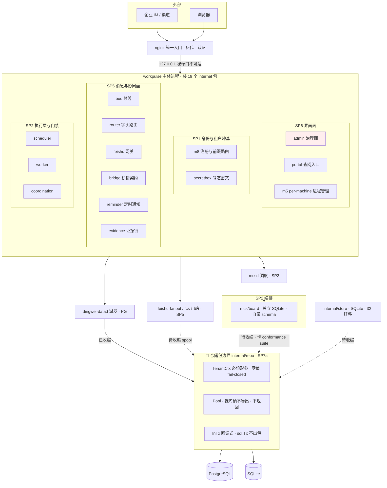
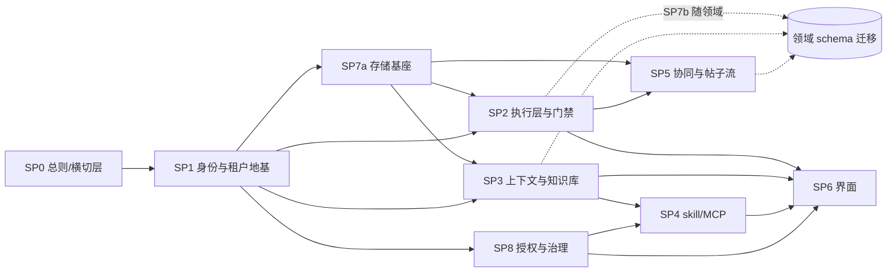

# 实现阶段总览交底（SP0–SP8）

> 🔴 **本件严格区分【事实】与【建议】**：标「事实」的均现取自仓内或已过闸的件，附取数处；
> 标「建议」的是本席的工程判断，可驳。
> ⚠️ **本件不含会过期的实数**：版本/锚/计数一律去 `docs/DELIVERY-STATUS.md` 与闸输出取。

## 一、架构总览图（事实：与架构设计 v0.15 的 A§5/A§6/A§8/A§12 同源）

### 1.1 仓储包边界画在哪（事实）

- 边界＝Go 包边界 `internal/repo`。**判据由闸执行**，非纪律：
  - 判据一：仓储包外的建库调用恒为 0（允许清单豁免；清单变更属评审面）
  - 判据二：裸库句柄逃出包外恒为 0（**允许清单对本条不豁免**）
- 现状：datad 已收编；`fanout/spool`、`mcs/board`、`internal/store` 未收编。实数见闸输出。

### 1.2 PEP 与 TenantCtx 卡在哪（事实 + 缺口）

| 关卡 | 位置 | 现状 |
|---|---|---|
| **TenantCtx** | `internal/repo` 所有查询入口的**必填形参** | ✅ 已落地：漏传＝编译错；零值＝`ErrNoTenant` 拒 |
| **租户过滤注入位** | `repo.Pool.Exec/Query/QueryRow` 内部单点 | ⚠️ **位已留，过滤未实现**——领域表尚无租户列 |
| **PEP（策略执行点）** | §22.2a 要求在 **selector/资源解析之前** | 🔴 **尚未实现**，属 SP1/SP8 面 |

🔴 **因此现在只能表述为「正常路径已收敛」，不得表述为「租户隔离已实现」**（§22.2c 开篇原文）。

## 二、SP0–SP8 全表（事实：SpecDoc §0.3 + 架构设计 A§6/A§6.1）

| 编号 | 一句话目标 | 覆盖 SpecDoc | 触及模块（A§6.1 逐包归属） | 对外接口／契约 | 前置 | 可否并行 | 需过的门 |
|---|---|---|---|---|---|---|---|
| **SP0** 总则与定义层 | 把定义、纪律、自检通则钉成唯一载体 | §1–§4、附录 A | `model` `config` `clock` `version` `jcs` `llm` `schedule`（**横切层，owner=SP0**） | 核心领域类型；`jcs` 规范序列化＝帖子 digest 地基 | 无 | ✅ 可与全部并行 | L2 |
| **SP1** 身份与租户地基 | per-session principal 与三级映射落地 | §21 §22.1/3/4 §7.1 P1 | `m8` `secretbox` | trusted principal 端到端链（A§8.1） | SP0 | ⚠️ 它是别人的前置 | **L3 安全面** |
| **SP7a** 存储基座 | 受控仓储 API · 迁移 runner · 访问抽象层 | §22.2c 配套 | `internal/repo`（新）`store` `datad/pgstore` | `TenantCtx` · `Pool` · `InTx` | **SP1** | 内部四对象可部分并行 | **L3** |
| **SP7b** 领域 schema 迁移与 cutover | 各领域自己的表迁移与切换 | 附录 C.3 | 无独立代码 | 各领域 schema 契约 | 🔴 **由 SP2/SP3/SP5 各自交付，不作统一前置** | 随各领域 | **L3 不可回滚须复核** |
| **SP8** 授权与平台治理 | 待决队列与批次签署 | §23 §24 | `admin`（治理面） | 授权决策接口；capability 判定 | SP1 | ✅ 与 SP7a 并列 | **L3 安全面** |
| **SP2** 执行层与门禁 | 门 verdict 独立化、board 状态机 | §5–§9 | `mcs`(board·demo) `scheduler` `worker` `coordination` | 门 verdict 契约；board 并发语义 | SP0 SP1 **SP7a** | 与 SP3 并行 | **L3 数据模型改语义** |
| **SP3** 上下文与知识库 | 四维知识模型落库 | §10–§13 | `datad`(kb) `redact` | 知识条目模型；入库前脱敏 | SP1 **SP7a** | 与 SP2 并行 | L2 |
| **SP4** skill / MCP 体系 | skill 与 MCP 目录、晋升审批 | §14–§16 | **无现有代码，全新** | capability catalog（A§16 合同） | SP1 SP3 **SP8** | 与 SP5 并行 | **L3 安全面** |
| **SP5** 协同与帖子流 | 帖子流模型、外部锚 hash-chain | §17–§20 | `bus` `router` `feishu` `fanout` `bridge` `reminder` `evidence` `fcs` | 帖子流模型；外部锚（A§19） | SP1 SP2 **SP7a** | 与 SP4 并行 | L2 |
| **SP6** 平台能力与界面 | 界面与平台能力呈现 | §25–§27 | `admin` `portal` `m5`；**view 无独立包**（为 m8 内 `/internal/view/*` 路由） | 原型 v1.16 为设计输入 | SP1 SP2 SP3 SP4 SP8 | ❌ 最末 | L2；**待产品原型图** |

**依赖顺序（事实，SpecDoc §0.3 原文）**：`SP0 → SP1 → {SP7a, SP8} → {SP2, SP3} → {SP4, SP5} → SP6`；SP7b 随各领域走。

## 三、拆分基于什么（事实：SpecDoc §0.3 + A§6.1）

**主轴是「契约边界」，不是模块，也不是判据。** 三条佐证：

1. **按 SpecDoc 章节段切**：每个 SP 认领一段连续章节（§1–4 / §5–9 / §10–13 …）——切的是**规范契约**。
2. **消环的那一刀就是契约刀**：SP7 原本整体前置于 SP2/SP3/SP5 会成环（存储要等领域模型，领域模型要等存储）。消环办法是把 **机制基座（SP7a）** 与 **领域 schema（SP7b）** 切开——切点正是「谁定义这份契约」。
3. **反查双向闭合**：A§6.1 要求正查每个 SP 有承载、反查每个包有归属，27 个 `internal` 包全部有归属；横切层（`model`/`jcs` 等）**不归单一 SP，owner 是 SP0**。

⚠️ **甲组/乙组判据不是拆分轴**，它们是 **SP7a 内部的验收轴**——甲组验收口、乙组验隔离。把它当拆分轴会误以为有个"甲组 SP"。

## 四、依赖关系图与硬前置（事实）

**串行链（最长）**：`SP0 → SP1 → SP7a → SP2 → SP5 → SP6`（六环）。
**互不相干（同层可并列）**：`{SP7a, SP8}`、`{SP2, SP3}`、`{SP4, SP5}`。

### 硬前置清单（事实）

| # | 硬前置 | 出处 | 现状 |
|---|---|---|---|
| 1 | `mcs/board` 收编**须待 conformance suite** | SpecDoc §4.5 | ⛔ suite 不存在 ⇒ board 收编不得开工 |
| 2 | `board.task → board_task` 改名**随 board 收编做** | §5.6a + A§21 #12 | ⛔ 同上；过渡纪律：新代码不得新增 `board.task` 引用 |
| 3 | SP4 晋升审批依赖 SP8 | §0.3 | ⛔ SP8 未开工 |
| 4 | SP6 待**产品原型图** | §0.3 | ⛔ 外部输入未到 |
| 5 | SP7b 不作统一前置，由 SP2/SP3/SP5 各自交付 | §0.3 | — 设计如此，非阻塞 |
| 6 | 🔴 **SP7a 的前置是 SP1，而 SP1 未落地** | §0.3「SP1（隔离策略需 tenant 语义先定）」 | ⛔ **见第五节，这是当前最要紧的一条** |

## 五、能不能开多线并行（🔴 本节为【判断】，请当技术判断读，不迁就期望答案）

### 5.1 先答业主最关心的那句：**能，但宽度是 2–3，不是 5–8；且当前顺序本身跳了一环**

🔴 **最要紧的事实先说**：SpecDoc §0.3 写明 **SP7a 的前置是 SP1**，理由原文是「隔离策略需 tenant 语义先定」。
而 **SP1 尚未落地**（A§6：现状仅 `m8`+`secretbox`，差距「三级映射未完整落地」；实测全仓 `TenantCtx` 在本轮之前为零实现、领域表无租户列、PEP 无实现）。

**后果不是抽象的**：SP7a 已建出 `TenantCtx` 类型与注入位，但**注不进任何东西**——因为没有租户列，也没有 principal 来源。
⇒ **真正的瓶颈是 SP1，不是 SP7a。** 现在多派人手去 SP2/SP3/SP5，他们同样会撞上「没有 tenant 语义」这堵墙。

### 5.2 哪些接口已可视为冻结、哪些还会动（判断，逐条给依据）

**已可视为冻结**（有权威定义且已过闸／已裁）：

| 契约 | 依据 | 冻结度 |
|---|---|---|
| `§22.2c` 受控仓储 API 五条必做 | 业主 v3.7 裁定，SpecDoc 生效 | 🟢 冻 |
| `§22.2a` 隔离四项同时验 | 乙域 terra AD-SA-01 已 PASS | 🟢 冻 |
| `board_task` 表名 | §5.6a 权威定义，名已裁 | 🟢 冻 |
| 凭据分级 S0–S2 | 外部既有口径，本件无权改 | 🟢 冻 |
| `jcs` 规范序列化 | 帖子 digest 地基，immutable 候选 | 🟢 冻（改它即改全部已封存帖子可验证性）|
| A§21 转交合同的**五列格式** | sol 总则，格式已定 | 🟢 冻（格式冻，**内容未验收**）|

**仍会动**（不宜多线开工）：

| 契约 | 为什么会动 |
|---|---|
| 各领域 schema | §0.3 明写由 SP2/SP3/SP5 各自定义，现在都没定 |
| capability catalog 条目 | A§16 只定了**设计合同**，条目未产出 |
| 帖子流模型 · 四维知识模型 | SP5/SP3 的核心产物，尚未建模 |
| 界面 | 待产品原型图（外部输入） |
| **架构设计 v0.15 全件作为验收依据** | 🔴 只过架构评审，**用例评审与交付验证未过** ⇒ **可作设计依据，不可作交付验收依据** |

⇒ **业主的疑点成立**：接口不冻就多线开工＝返工。但不是全都没冻——冻的是**机制层**，没冻的是**领域层**。

### 5.3 建议的并行编队（判断）

**宽度 3，按「契约冻结度」分线，不按 SP 分线：**

| 线 | 内容 | 为什么现在能开 | 边界（互不踩） |
|---|---|---|---|
| **甲线（关键路径，1 人）** | **SP1 身份与租户地基** | 它是所有人的前置，且是当前真瓶颈 | `internal/m8` `internal/secretbox` |
| **乙线（1 人）** | SP7a 剩余收编：`fanout/spool` → `internal/store` | 机制层契约已冻（§22.2c），不依赖领域 schema | `internal/fanout` `internal/store` `internal/repo` |
| **丙线（1 人）** | **`mcs/board` conformance suite**（不是 board 收编本身） | §4.5 要求 suite 先于重写；写 suite 只需**既有行为**，不需新契约 | `internal/mcs/board` 的测试面 |

🔴 **丙线是把硬前置变成可开工项的唯一办法**：suite 不写，board 永远卡着；而写 suite 不受任何未冻契约影响。

**暂不开的**：SP2/SP3/SP5（等 SP1 + 各自 schema）、SP4（等 SP8）、SP6（等原型图）。
**SP8 可作第四线**，但它是 L3 安全面、且与 SP1 在 principal 语义上高度耦合，**建议并入甲线或紧随其后**，不单开。

### 5.4 需要 worktree／分支隔离吗（判断：**需要**）

同仓同分支多线写＝冲突源，这一条业主判得对。建议：
- 每线一个 **git worktree + 独立分支**，只在收口时合回 `design/addendum-decisions`。
- 三线触及的包**互不重叠**（见上表），冲突面主要不在代码，而在**共享件**：`docs/DELIVERY-STATUS.md`、`specs/gates/boundary-baseline.txt`。

## 六、多线如何协调（事实 + 判断）

### 6.1 转交合同 A§21 怎么用在多线之间（事实）

A§21 十二项**每项已标明验收门归哪个 SP**，其中**六项是跨 SP 共同验收**：
`#8 SP5+SP2`、`#9 SP5+SP3`、`#10 SP7a+SP6`、`#11 SP2+SP5+SP7a`、`#12 SP7a+SP2`。
⇒ **它天然就是多线之间的交接单**：一项挂两个 SP，就是两条线必须对齐的那个点。

**纪律（A§21.1 原文，事实）**：① 本表不得只增不减，验收通过须划掉并注明验收锚；② 不得以「设计已定」代替验收；③ 新增项须五列齐，缺一列不得转交。

### 6.2 各线产物如何汇（判断）

- **每线收口时提供**：分支 + 合并锚 + 该线触及的 A§21 项号 + 闸输出全文。
- **coordinator 无仓访问** ⇒ 各线回报**必须消息自足**（含锚、sha256、行字节、闸计数），不得只给仓内路径。

### 6.3 🔴 棘轮闸在多线并发提交下会不会打架（判断：**会，但打的是明处**）

**会冲突，形态如下**：`specs/gates/boundary-baseline.txt` 是单一计数文件。乙线把 `open` 由 6 降到 5、丙线也降到 5，两分支合并 ⇒ **Git 文本冲突**。

**为什么这是好事**：它是**显式冲突**，不是静默错误——两条线各降一处、合并后实际应为 4，若基线被谁的版本覆盖成 5，棘轮就松了一格。冲突逼人手工看一眼。

**处置建议（三条）**：
1. **合并冲突一律取更小值**——棘轮只许下行，这条可写进 CONTRIBUTING，也可做成合并驱动。
2. **合并后必须重跑一次闸**：闸会实算当前值并自动收紧基线，因此**合并后跑一次即自愈**（当前实现已具备该行为）。
3. 🔴 **不要把基线移出仓来"避免冲突"**——那会同时消灭棘轮的历史比较能力，属于用丢掉判据来换取方便。

⚠️ 另一处共享件 `docs/DELIVERY-STATUS.md` 由 pre-commit 自动重生成，多线各自生成必然冲突；**它是生成物，冲突时直接重跑 `scripts/gen-status.sh` 覆盖即可**，不必手工合并。

## 七、本件的边界

- 第一、二、三、四节与 6.1 为**事实**，取自 SpecDoc §0.3 / 架构设计 A§5–A§8 · A§12 · A§21 与仓内实测。
- 第五节与 6.2、6.3 为**本席的工程判断**，可驳。
- 🔴 架构设计 v0.15 **只过架构评审**，用例评审与交付验证未过 ⇒ 本件引用它作**设计依据**，不得据以做**交付验收**。
